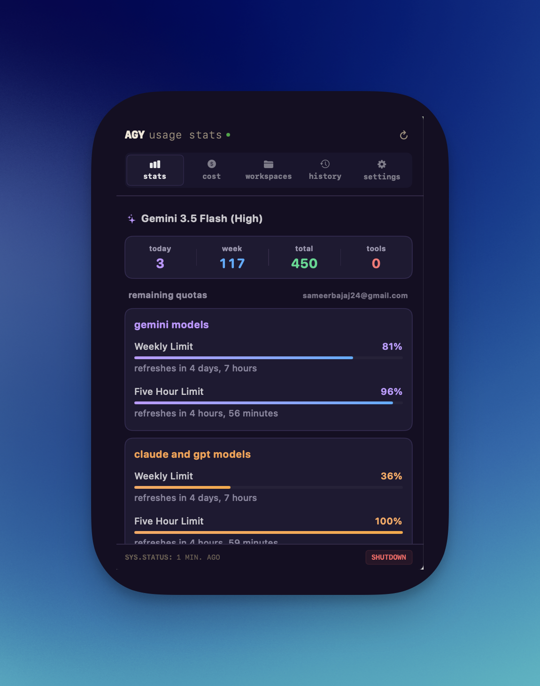

# Antigravity Usage Stats

[](https://github.com/sameerbajaj/agy-usage-stats/releases/latest)
[](https://www.apple.com/macos/)
[](https://developer.apple.com/xcode/swiftui/)
[](LICENSE)

A native macOS menu bar application for monitoring local [Google Antigravity CLI](https://antigravity.google) (`agy`) activity. It provides a real-time dashboard for token quotas, rate limits, model depletion, and API spending across all active workspaces.

<p align="center">
  
</p>

---

## Features

- **Glanceable Status Item**: Custom CoreGraphics-rendered status icon with a decoupled circular ring gauge and remaining percentage number, dynamically color-coded by quota health (Green `>50%`, Amber `20–50%`, Red `≤20%`).
- **Dynamic Depletion Tracking**: Automatically detects and monitors whichever model is actively burning quota fastest across concurrent terminal sessions (Argon, Sonnet 5.5, Opus 5.5, Gemini 2.5).
- **Multi-Account & Dual-Box Ingestion**: Concurrently monitors consumer subscription quotas (`~/.gemini/antigravity-cli`) and Google Cloud direct billing (`~/.agy-gcp-home`), with interactive account filtering (`All | Sub | GCP`) and credit baseline tracking.
- **Frontier Model Cost Engine**: Real-time spending estimates for Gemini 4 Argon, Claude Sonnet 5.5, and Claude Opus 5.5, factoring in thinking/reasoning effort tiers and 95% prompt cache discounts.
- **Interactive Daily Spend Breakdown**: Interactive bar chart displaying daily spend with peak-day callouts across 7-day, 30-day, and all-time windows.
- **Kernel-Level File Watching**: Leverages macOS `kqueue` event monitors (`DispatchSource.makeFileSystemObjectSource`) with debounced updates (300ms) and `<1ms` in-memory signature caching. Zero polling overhead, 0.00% idle CPU impact, and zero token burn.
- **Native macOS Hover Tooltip**: Hovering over the menu bar icon displays an instant summary of active models, Claude and Gemini quota percentages, and today's total query count without opening the popover.
- **Automatic Daemon Discovery**: Direct socket inspection via `lsof` locates the active `agy` daemon process listening on localhost and queries its status endpoints with zero ps-table scanning.

---

## How It Works

Antigravity Usage Stats operates entirely on-device with zero external network requests:

1. **Kernel File Monitoring**: Attaches lightweight macOS kqueue watchers to `~/.gemini/antigravity-cli/history.jsonl` and the SQLite conversation databases. Statistics update within 300ms of any prompt completion.
2. **Localhost Daemon Socket Probe**: Discovers the active Antigravity language server port via direct listening socket lookups and retrieves quota groups and reset timers.
3. **Local In-Memory Cache**: Memoizes parsed records and token counts against filesystem modification timestamps, ensuring sub-millisecond popover rendering.

---

## Installation

### Direct Download
1. Download the latest release: [**agy-usage-stats-latest.dmg**](https://github.com/sameerbajaj/agy-usage-stats/releases/latest/download/agy-usage-stats-latest.dmg).
2. Open the `.dmg` and drag `agy-usage-stats.app` into your `/Applications` directory.
3. Launch the app from Applications or Spotlight.

> **Note**: Requires macOS 15.0 (Sequoia) or later with the Antigravity CLI (`agy`) installed.

---

## Development

You can build and test the project locally with Xcode or the command line.

### Requirements
- macOS 15.0+
- Xcode 16.0+
- Swift 6.0

### Run Tests
The test suite uses Swift Testing (`import Testing`) with isolated, hermetic fixtures:
```bash
xcodebuild test \
  -project agy-usage-stats.xcodeproj \
  -scheme agy-usage-stats \
  -destination 'platform=macOS' \
  -only-testing:agy-usage-statsTests \
  CODE_SIGN_IDENTITY="-"
```

### Build a Release DMG
To package a distributable `.dmg`:
```bash
./scripts/build-dmg.sh v1.1.0
```

---

## License

This project is licensed under the MIT License. See [LICENSE](LICENSE) for details.
